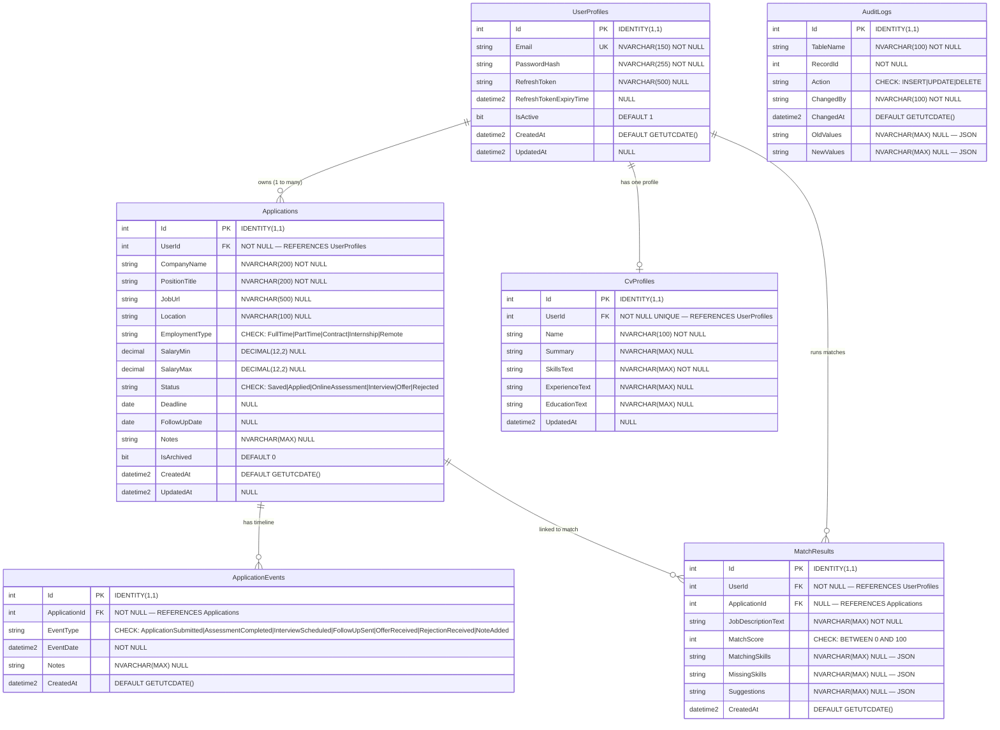
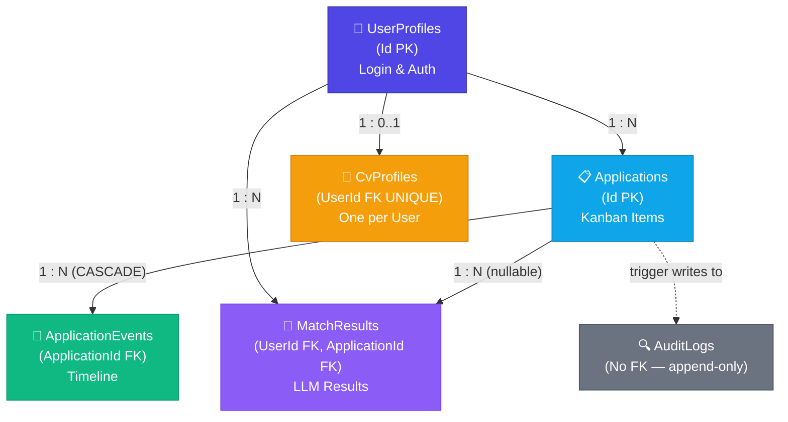

# Job Application Tracker — Database Entity Relationship Diagram (ERD)

> **Current-source note:** This detailed ERD is the documentation template. Reconcile it against the current EF Core mappings. Application ownership (`UserId`) is enforced in every service method — never rely solely on database constraints for user isolation.

| Field           | Details                                    |
|-----------------|--------------------------------------------|
| **Document**    | Job Application Tracker DB ERD             |
| **Database**    | `JobTracker_DB` — SQL Server 2022           |
| **Version**     | 1.0                                        |
| **Status**      | Ready for Implementation                   |
| **Date**        | 2026-10-14                                 |
| **Tables**      | 6                                          |
| **Relationships** | 6 foreign key constraints               |
| **Related BRDs** | BRD-03 (Schema), BRD-04 (Procs), BRD-05 (EF Core) |

---

## 1. Full Entity Relationship Diagram



---

## 2. Table Descriptions

### 2.1 `UserProfiles`
Stores user accounts — login credentials, JWT refresh tokens, and account status. Separated from application data to allow future roles such as Admin or Recruiter without polluting the application model.

| Column | Type | Constraints | Notes |
|--------|------|-------------|-------|
| `Id` | `INT` | PK, IDENTITY | Auto-increment primary key |
| `Email` | `NVARCHAR(150)` | NOT NULL, UNIQUE | Login identifier |
| `PasswordHash` | `NVARCHAR(255)` | NOT NULL | BCrypt-hashed password |
| `RefreshToken` | `NVARCHAR(500)` | NULL | JWT refresh token (rotated on use) |
| `RefreshTokenExpiryTime` | `DATETIME2` | NULL | Refresh token expiry |
| `IsActive` | `BIT` | DEFAULT 1 | Whether the account can log in |
| `CreatedAt` | `DATETIME2` | DEFAULT GETUTCDATE() | Account creation timestamp |
| `UpdatedAt` | `DATETIME2` | NULL | Last profile update |

**Business Rules:**
- Login uses `Email` + `PasswordHash` (BCrypt comparison)
- `RefreshToken` is rotated on every use to prevent token reuse
- `IsActive = 0` blocks login without deleting the account

---

### 2.2 `Applications`
Core entity — one row per job or internship application. Implements the Kanban status workflow.

| Column | Type | Constraints | Notes |
|--------|------|-------------|-------|
| `Id` | `INT` | PK, IDENTITY | |
| `UserId` | `INT` | FK → `UserProfiles`, NOT NULL | Ownership key — always required in queries |
| `CompanyName` | `NVARCHAR(200)` | NOT NULL | |
| `PositionTitle` | `NVARCHAR(200)` | NOT NULL | |
| `JobUrl` | `NVARCHAR(500)` | NULL | Full URL to the original posting |
| `Location` | `NVARCHAR(100)` | NULL | City, country, or "Remote" |
| `EmploymentType` | `NVARCHAR(30)` | CHECK constraint | `FullTime`, `PartTime`, `Contract`, `Internship`, `Remote` |
| `SalaryMin` | `DECIMAL(12,2)` | NULL | Optional salary floor |
| `SalaryMax` | `DECIMAL(12,2)` | NULL | Optional salary ceiling |
| `Status` | `NVARCHAR(30)` | NOT NULL, CHECK, DEFAULT 'Saved' | Kanban status |
| `Deadline` | `DATE` | NULL | Application deadline |
| `FollowUpDate` | `DATE` | NULL | Reminder date for follow-up |
| `Notes` | `NVARCHAR(MAX)` | NULL | Free-text notes |
| `IsArchived` | `BIT` | DEFAULT 0 | Soft-delete flag |
| `CreatedAt` | `DATETIME2` | DEFAULT GETUTCDATE() | |
| `UpdatedAt` | `DATETIME2` | NULL | |

**Status Transition Rules:**
```
Saved        → Applied, Rejected
Applied      → OnlineAssessment, Interview, Offer, Rejected
OnlineAssessment → Interview, Rejected
Interview    → Offer, Rejected
Offer        → (terminal)
Rejected     → (terminal)
```

**Business Rules:**
- `IsArchived = 1` hides applications from all user-facing queries (EF Core global query filter)
- Every status change auto-creates an `ApplicationEvent` record
- `SalaryMax` must be ≥ `SalaryMin` when both are provided (service-level validation)

---

### 2.3 `ApplicationEvents`
Timeline log — one row per milestone per application (interview scheduled, follow-up sent, etc.).

| Column | Type | Constraints | Notes |
|--------|------|-------------|-------|
| `Id` | `INT` | PK, IDENTITY | |
| `ApplicationId` | `INT` | FK → `Applications`, NOT NULL, CASCADE DELETE | |
| `EventType` | `NVARCHAR(50)` | NOT NULL, CHECK constraint | See allowed values below |
| `EventDate` | `DATETIME2` | NOT NULL | When the event occurred |
| `Notes` | `NVARCHAR(MAX)` | NULL | Additional context |
| `CreatedAt` | `DATETIME2` | DEFAULT GETUTCDATE() | |

**Allowed EventType values:**
`ApplicationSubmitted`, `AssessmentCompleted`, `InterviewScheduled`, `FollowUpSent`, `OfferReceived`, `RejectionReceived`, `NoteAdded`

**Business Rules:**
- Cascade delete when parent `Application` is archived (hard delete cascade in SQL; soft-delete in EF Core)
- `EventDate` cannot be in the future

---

### 2.4 `CvProfiles`
Stores a user's text-based CV summary used for LLM matching. One profile per user.

| Column | Type | Constraints | Notes |
|--------|------|-------------|-------|
| `Id` | `INT` | PK, IDENTITY | |
| `UserId` | `INT` | FK → `UserProfiles`, NOT NULL, UNIQUE | Enforces one-to-one with `UserProfiles` |
| `Name` | `NVARCHAR(100)` | NOT NULL | Display name for the profile |
| `Summary` | `NVARCHAR(MAX)` | NULL | Professional summary |
| `SkillsText` | `NVARCHAR(MAX)` | NOT NULL | Skills list — required for matching |
| `ExperienceText` | `NVARCHAR(MAX)` | NULL | Work experience narrative |
| `EducationText` | `NVARCHAR(MAX)` | NULL | Education details |
| `UpdatedAt` | `DATETIME2` | NULL | |

**Business Rules:**
- `UNIQUE (UserId)` — exactly one CV profile per user account
- `SkillsText` is required — the matching service will reject a match request if this is empty
- Created on first `PUT /api/cv-profile`, updated on subsequent PUTs (upsert behavior)

---

### 2.5 `MatchResults`
Stores the result of each LLM CV-to-job matching operation. Append-only — results are never updated, only created.

| Column | Type | Constraints | Notes |
|--------|------|-------------|-------|
| `Id` | `INT` | PK, IDENTITY | |
| `UserId` | `INT` | FK → `UserProfiles`, NOT NULL | Result ownership |
| `ApplicationId` | `INT` | FK → `Applications`, NULL | Linked application (nullable for standalone matches) |
| `JobDescriptionText` | `NVARCHAR(MAX)` | NOT NULL | The pasted job description used for this match |
| `MatchScore` | `INT` | NOT NULL, CHECK 0–100 | Overall match score |
| `MatchingSkills` | `NVARCHAR(MAX)` | NULL | JSON array of matching skills |
| `MissingSkills` | `NVARCHAR(MAX)` | NULL | JSON array of missing/weak skills |
| `Suggestions` | `NVARCHAR(MAX)` | NULL | JSON array of improvement suggestions |
| `CreatedAt` | `DATETIME2` | DEFAULT GETUTCDATE() | |

**Business Rules:**
- `ApplicationId` is nullable — a user can run a standalone match without linking it to an application
- JSON columns store arrays: `["TypeScript", "REST APIs"]`
- `MatchScore` must always be between 0 and 100 (CHECK constraint)
- Never edited after creation

---

### 2.6 `AuditLogs`
System-wide immutable audit trail. Written by triggers and application code. **Never updated — append-only.**

| Column | Type | Constraints | Notes |
|--------|------|-------------|-------|
| `Id` | `INT` | PK, IDENTITY | |
| `TableName` | `NVARCHAR(100)` | NOT NULL | Audited table name |
| `RecordId` | `INT` | NOT NULL | PK of the audited record |
| `Action` | `NVARCHAR(20)` | CHECK: `INSERT`\|`UPDATE`\|`DELETE` | |
| `ChangedBy` | `NVARCHAR(100)` | NOT NULL | Authenticated user email |
| `ChangedAt` | `DATETIME2` | DEFAULT GETUTCDATE() | |
| `OldValues` | `NVARCHAR(MAX)` | NULL | JSON snapshot before change |
| `NewValues` | `NVARCHAR(MAX)` | NULL | JSON snapshot after change |

**Business Rules:**
- `AuditLogs` has **no foreign keys** — it must survive even if source records are hard deleted
- Only INSERT operations are ever performed against this table
- Written by the `trg_Applications_Audit` trigger and by application code

---

## 3. Relationship Map



---

## 4. Index Catalogue

| Index Name | Table | Column(s) | Type | Purpose |
|---|---|---|---|---|
| `IX_UserProfiles_Email` | `UserProfiles` | `Email` | Non-Clustered Unique | Login lookup |
| `IX_Applications_UserId` | `Applications` | `UserId` WHERE `IsArchived=0` | Filtered Non-Clustered | User's application list |
| `IX_Applications_Status` | `Applications` | `UserId, Status` | Composite Non-Clustered | Status filter + dashboard |
| `IX_Applications_Deadline` | `Applications` | `UserId, Deadline` WHERE `IsArchived=0` | Filtered Non-Clustered | Upcoming deadline widget |
| `IX_Applications_FollowUp` | `Applications` | `UserId, FollowUpDate` | Composite Non-Clustered | Follow-up reminder queries |
| `IX_Applications_Created` | `Applications` | `CreatedAt` | Non-Clustered | Time-sorted list |
| `IX_AppEvents_ApplicationId` | `ApplicationEvents` | `ApplicationId` | Non-Clustered | Timeline lookup |
| `IX_AppEvents_EventDate` | `ApplicationEvents` | `ApplicationId, EventDate` | Composite Non-Clustered | Ordered timeline |
| `IX_CvProfiles_UserId` | `CvProfiles` | `UserId` | Non-Clustered Unique | One CV per user |
| `IX_MatchResults_UserId` | `MatchResults` | `UserId` | Non-Clustered | Match history per user |
| `IX_AuditLogs_Table` | `AuditLogs` | `TableName, ChangedAt` | Composite Non-Clustered | Audit trail filtering |

---

## 5. Key Design Decisions

### 5.1 Soft Delete Pattern (`IsArchived`)
`Applications` use `IsArchived BIT DEFAULT 0` instead of physical deletion. This preserves the full application history and keeps referential integrity intact for linked `ApplicationEvents` and `MatchResults`. EF Core applies a global query filter so archived applications are automatically excluded from all user-facing queries.

### 5.2 Ownership as a First-Class Constraint
`Applications`, `CvProfiles`, and `MatchResults` all carry a `UserId` FK. Every service method in the backend receives the authenticated `userId` from the JWT claim and includes it in every query. This prevents cross-user data access even if an attacker knows a valid application ID.

### 5.3 One-to-One CV Profile
The `UNIQUE (UserId)` constraint on `CvProfiles.UserId` ensures a user can have exactly one text-based CV profile. This simplifies the matching workflow — the backend always knows which profile to use without requiring the user to select one.

### 5.4 Append-Only MatchResults
`MatchResults` are never updated. Each call to the matching endpoint creates a new row, building a history of past comparisons. The user can track how their match score changes as they update their CV profile.

### 5.5 JSON Columns for Matching Output
`MatchingSkills`, `MissingSkills`, and `Suggestions` are stored as `NVARCHAR(MAX)` containing JSON arrays. This allows the LLM to return variable-length lists without schema changes. The application layer serializes/deserializes these fields.

### 5.6 Cascade Delete for Timeline Events
`ApplicationEvents` cascade-delete when their parent `Application` is hard deleted. In practice, applications are only soft-deleted (archived), so the cascade fires only if an admin performs a permanent deletion.

### 5.7 Append-Only AuditLogs
`AuditLogs` has no FK constraints intentionally — records must survive even if source rows are deleted. Old and new values are stored as JSON snapshots using SQL Server's `FOR JSON PATH` syntax.

### 5.8 DECIMAL for Monetary Columns
`SalaryMin` and `SalaryMax` use `DECIMAL(12,2)` — never `FLOAT` or `MONEY`. This avoids floating-point precision errors when displaying salary ranges.

---

## 6. Foreign Key Summary

| FK Column | Table | References | On Delete |
|---|---|---|---|
| `Applications.UserId` | `Applications` | `UserProfiles.Id` | CASCADE |
| `ApplicationEvents.ApplicationId` | `ApplicationEvents` | `Applications.Id` | CASCADE |
| `CvProfiles.UserId` | `CvProfiles` | `UserProfiles.Id` | CASCADE |
| `MatchResults.UserId` | `MatchResults` | `UserProfiles.Id` | NO ACTION |
| `MatchResults.ApplicationId` | `MatchResults` | `Applications.Id` | SET NULL |

> **Note:** `AuditLogs` has **no foreign keys** — it is append-only and must survive even if source records are deleted.

---

## 7. Data Volume Estimates (Production)

| Table | Est. Rows / Year (per active user) | Growth Pattern |
|---|---|---|
| `UserProfiles` | 500–5,000 total | Slow (user registration) |
| `Applications` | 50–500 per user | Moderate (active job seekers) |
| `ApplicationEvents` | 150–2,000 per user | Moderate |
| `CvProfiles` | 1 per user | Very low |
| `MatchResults` | 10–100 per user | Moderate |
| `AuditLogs` | 500,000+ total | **High** — every application update |

> ⚠️ `AuditLogs` is the highest-growth table. Consider **partitioning by month/year** for production systems with > 1 M rows.

---

*Document Owner: Training Lead | Related: [BRD-03](BRD-03-SQL-Fundamentals.md) · [BRD-04](BRD-04-Advanced-SQL.md) · [BRD-05](BRD-05-ADONet-EFCore.md)*
