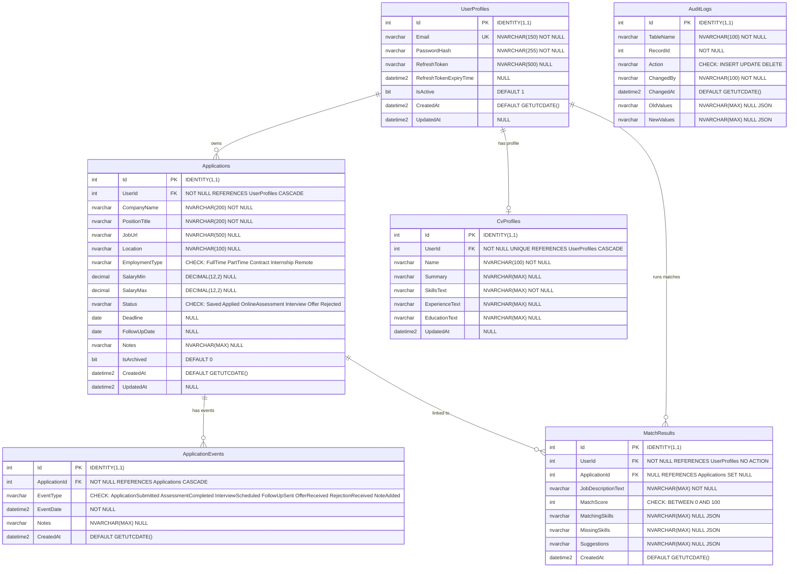
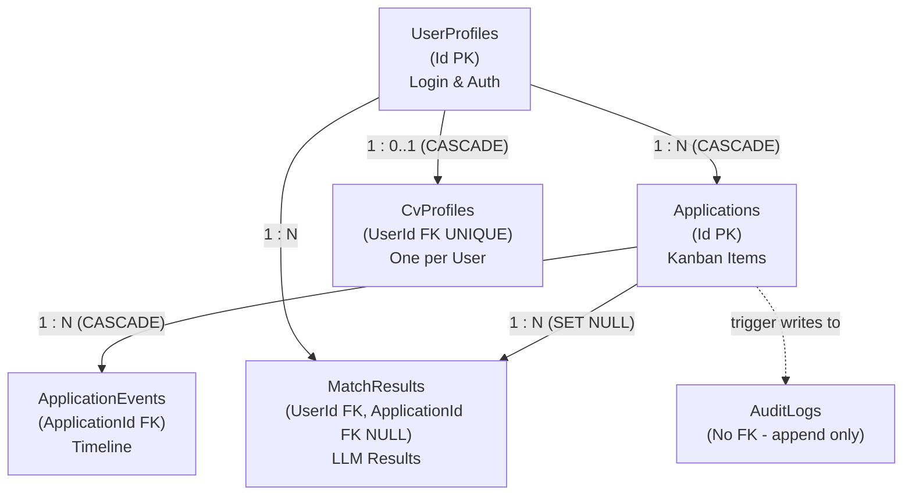

# Job Application Tracker — Database Schema Diagram

> **Current-source note:** EF Core entity configurations and migrations are authoritative for the deployed schema. The `UserId` ownership filter is applied in every service method — never in the Angular frontend. All audit values are stamped in the `DbContext`, not by SQL triggers (unless the advanced SQL trigger is also implemented).

> 6 tables · 5 foreign key relationships · SQL Server 2022
>
> Based on the Job Application Tracker ERD and BRDs 03–05.

---

## 1. Entity Relationship Diagram (Mermaid)

---

## 2. Relationship Flow Diagram (Mermaid)

---

## 3. Foreign Key Reference Table

| FK Column | Source Table | References | On Delete |
|---|---|---|---|
| `Applications.UserId` | Applications | UserProfiles.Id | CASCADE |
| `ApplicationEvents.ApplicationId` | ApplicationEvents | Applications.Id | CASCADE |
| `CvProfiles.UserId` | CvProfiles | UserProfiles.Id | CASCADE |
| `MatchResults.UserId` | MatchResults | UserProfiles.Id | NO ACTION |
| `MatchResults.ApplicationId` | MatchResults | Applications.Id | SET NULL |

> **AuditLogs** has **no foreign keys** — it is append-only and must survive even if source records are deleted.

---

## 4. Index Catalogue

| Index Name | Table | Column(s) | Type | Purpose |
|---|---|---|---|---|
| `IX_UserProfiles_Email` | UserProfiles | Email | Non-Clustered Unique | Login lookup |
| `IX_Applications_UserId` | Applications | UserId (WHERE IsArchived=0) | Filtered Non-Clustered | User's application list |
| `IX_Applications_Status` | Applications | UserId, Status | Composite Non-Clustered | Dashboard + Kanban filter |
| `IX_Applications_Deadline` | Applications | UserId, Deadline (WHERE IsArchived=0) | Filtered Non-Clustered | Upcoming deadline widget |
| `IX_Applications_FollowUp` | Applications | UserId, FollowUpDate | Composite Non-Clustered | Follow-up reminders |
| `IX_Applications_Created` | Applications | CreatedAt | Non-Clustered | Time-sorted list |
| `IX_AppEvents_ApplicationId` | ApplicationEvents | ApplicationId | Non-Clustered | Timeline lookup |
| `IX_AppEvents_EventDate` | ApplicationEvents | ApplicationId, EventDate | Composite Non-Clustered | Ordered timeline |
| `IX_CvProfiles_UserId` | CvProfiles | UserId | Non-Clustered Unique | One CV per user |
| `IX_MatchResults_UserId` | MatchResults | UserId | Non-Clustered | Match history per user |
| `IX_AuditLogs_Table` | AuditLogs | TableName, ChangedAt | Composite Non-Clustered | Audit trail filtering |

---

## 5. Unique Constraints

| Constraint | Table | Columns |
|---|---|---|
| `UQ_UserProfiles_Email` | UserProfiles | Email |
| `UQ_CvProfiles_UserId` | CvProfiles | UserId |

---

## 6. Check Constraints

| Table | Column | Allowed Values |
|---|---|---|
| Applications | EmploymentType | `'FullTime'`, `'PartTime'`, `'Contract'`, `'Internship'`, `'Remote'` |
| Applications | Status | `'Saved'`, `'Applied'`, `'OnlineAssessment'`, `'Interview'`, `'Offer'`, `'Rejected'` |
| ApplicationEvents | EventType | `'ApplicationSubmitted'`, `'AssessmentCompleted'`, `'InterviewScheduled'`, `'FollowUpSent'`, `'OfferReceived'`, `'RejectionReceived'`, `'NoteAdded'` |
| MatchResults | MatchScore | `BETWEEN 0 AND 100` |
| AuditLogs | Action | `'INSERT'`, `'UPDATE'`, `'DELETE'` |

---

## 7. Design Decisions

| Decision | Rationale |
|---|---|
| **Soft Delete** (`IsArchived BIT`) | Preserves referential integrity, enables recovery, hidden by EF Core global query filter |
| **Ownership via UserId** | Every user-scoped table carries `UserId`. Every service method filters by it. This is the primary security boundary |
| **One-to-One CV Profile** | `UNIQUE (UserId)` on `CvProfiles` ensures exactly one profile per user. Simplifies matching — no profile selection needed |
| **JSON Columns for Matching** | `MatchingSkills`, `MissingSkills`, `Suggestions` stored as JSON arrays in `NVARCHAR(MAX)`. Avoids schema changes for variable-length LLM output |
| **Append-Only MatchResults** | Never edited — each match creates a new row. Users can track score improvement over time |
| **Append-Only AuditLogs** | No FKs — survives source record deletion. JSON snapshots via `FOR JSON PATH` |
| **Cascade Delete for Events** | Timeline events have no meaning without their parent application. CASCADE delete simplifies cleanup |
| **DECIMAL for Salary** | Never FLOAT/REAL/MONEY — avoids precision errors in salary range display |
| **PK named `Id`** | Convention-based naming. All primary keys are simply `Id` for consistency with `[Key]` data annotation |
| **NVARCHAR everywhere** | Full Unicode support for international company names, locations, and job descriptions |
