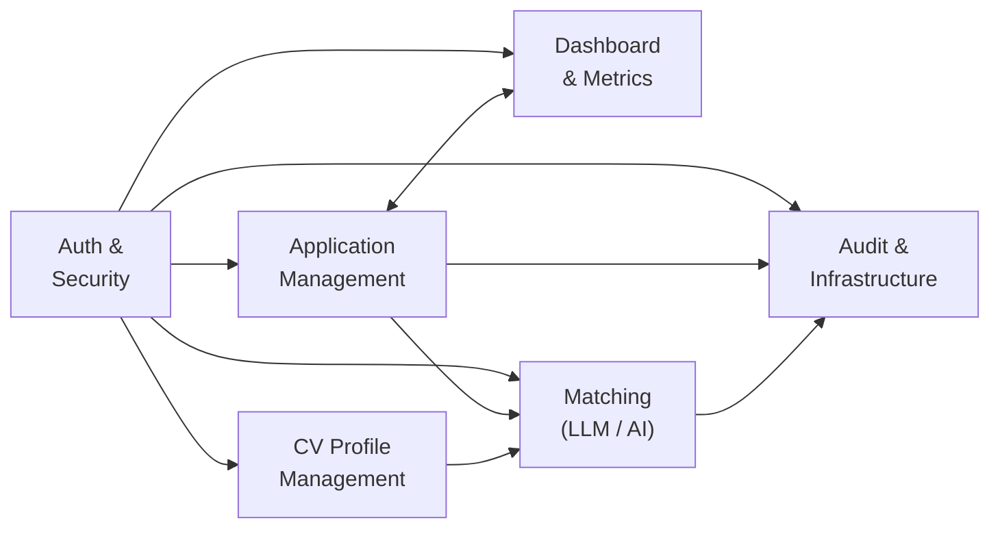

# Job Application Tracker — System Modules Blueprint

> **Current implementation note:** The full module blueprint and examples are preserved. Current source behavior overrides historical API rows: the implemented surface is the six-controller .NET 9 backend and its current EF Core model.

> Functional architecture of the Job Application Tracker system, organized by business domain.
> Each module represents a self-contained area of functionality with its own entities, APIs, services, and database objects.

---

## System Architecture Overview

```
┌─────────────────────────────────────────────────────────────────┐
│                   Job Application Tracker                        │
├────────────┬────────────┬────────────┬────────────┬─────────────┤
│  Auth &    │Application │  Dashboard │ CV Profile │  Matching   │
│  Security  │  & Kanban  │ & Metrics  │ Management │ (LLM / AI)  │
├────────────┴────────────┴────────────┴────────────┴─────────────┤
│                     Audit & Infrastructure                       │
└─────────────────────────────────────────────────────────────────┘
```

---

## Module 1: Authentication & Security

### Purpose
Controls user identity, session management, and ownership enforcement across the entire system. Every request to a protected endpoint must carry a valid JWT. Every data-access operation must include a `UserId` ownership filter.

### Database Tables

| Table | Role in Module |
|---|---|
| `UserProfiles` | Stores login credentials, password hashes, and refresh tokens. Decoupled from application data to allow future admin roles. |

### APIs

| # | Method | Endpoint | Description |
|---|---|---|---|
| 1 | POST | `/api/auth/signup` | Create a new user account (email + password) |
| 2 | POST | `/api/auth/login` | Authenticate user, return JWT + refresh token |
| 3 | POST | `/api/auth/refresh-token` | Exchange refresh token for new access token |

### Services & Components

| Component | Responsibility |
|---|---|
| `AuthController` | Handles signup/login/refresh HTTP requests |
| `IAuthService` / `AuthService` | JWT generation, BCrypt password hashing, refresh token rotation |
| `IUserRepository` / `UserRepository` | User lookup by email, refresh token management |
| JWT Middleware | Validates bearer tokens on every protected request |
| `ClaimsPrincipalExtensions` | `GetCurrentUserId()` — extracts `UserId` from JWT claims |

### Domain Entities

| Entity | Type | Key Properties |
|---|---|---|
| `UserProfile` | Class (extends EntityAudit) | Email, PasswordHash, RefreshToken, RefreshTokenExpiryTime, IsActive |

### Authorization Roles

| Role | Access |
|---|---|
| `User` | Own applications, own CV profile, own matching results, own dashboard |
| `Admin` | All user data (admin panel), user management |

### Security Rules
- Every JWT claim contains `UserId` — no endpoint uses email for data filtering
- All application data queries include `WHERE UserId = @currentUserId`
- Return `404 Not Found` (not `403 Forbidden`) when another user's resource is requested — prevents existence leakage
- Never log or return the refresh token in error messages

---

## Module 2: Application Management & Kanban

### Purpose
Full application lifecycle management — creating, tracking, updating, and archiving job/internship applications through a six-stage Kanban workflow.

### Database Tables

| Table | Role in Module |
|---|---|
| `Applications` | Core entity — one row per application, contains all tracking data |
| `ApplicationEvents` | Timeline events — one row per milestone (interview, follow-up, status change) |

### APIs

| # | Method | Endpoint | Description |
|---|---|---|---|
| 4 | GET | `/api/applications` | List user's applications (paginated, filterable by status, type, deadline) |
| 5 | GET | `/api/applications/{id}` | Get single application with full timeline |
| 6 | POST | `/api/applications` | Create a new application record |
| 7 | PUT | `/api/applications/{id}` | Update application details |
| 8 | PUT | `/api/applications/{id}/status` | Change status (enforces transition rules + logs event) |
| 9 | DELETE | `/api/applications/{id}` | Archive application (soft-delete, `IsArchived = 1`) |
| 10 | GET | `/api/applications/search` | Search by company, position, status, employment type, deadline range |
| 11 | GET | `/api/applications/export` | Export user's applications as CSV |
| 12 | POST | `/api/applications/{id}/events` | Add an interview, follow-up, or free-text note to the timeline |
| 13 | GET | `/api/applications/{id}/events` | Get full timeline ordered by event date |

### Services & Components

| Component | Responsibility |
|---|---|
| `ApplicationsController` | HTTP layer — routes, auth, response formatting |
| `IApplicationService` / `ApplicationService` | Business logic — ownership enforcement, status transition validation, CSV export |
| `IApplicationRepository` / `ApplicationRepository` | Data access — LINQ queries with `UserId` filter, search, pagination |
| `IEventRepository` / `EventRepository` | Timeline event data access |
| `CreateApplicationValidator` | FluentValidation — CompanyName, PositionTitle required; JobUrl is valid URL; SalaryMax ≥ SalaryMin |
| `UpdateApplicationValidator` | FluentValidation for updates |
| `ChangeStatusValidator` | Validates target status is a valid enum value |
| `AddEventValidator` | Validates EventType and EventDate (not in future) |

### Domain Entities

| Entity | Type | Key Properties |
|---|---|---|
| `Entity` | Abstract base class | `[Key] Id` — identity only |
| `EntityAudit` | Abstract (extends Entity) | CreatedAt, UpdatedAt, IsDeleted — implements IAuditable |
| `Application` | Sealed (extends EntityAudit) | UserId, CompanyName, PositionTitle, JobUrl, Location, EmploymentType, SalaryMin, SalaryMax, Status, Deadline, FollowUpDate, Notes, IsArchived |
| `ApplicationEvent` | Sealed (extends Entity) | ApplicationId, EventType, EventDate, Notes |
| `ApplicationStatus` | Enum | Saved, Applied, OnlineAssessment, Interview, Offer, Rejected |
| `EmploymentType` | Enum | FullTime, PartTime, Contract, Internship, Remote |
| `EventType` | Enum | ApplicationSubmitted, AssessmentCompleted, InterviewScheduled, FollowUpSent, OfferReceived, RejectionReceived, NoteAdded |

### SQL Objects

| Object | Type | Purpose |
|---|---|---|
| `usp_ChangeApplicationStatus` | Stored Procedure | Atomic status change: validates transition, updates Application, inserts ApplicationEvent, writes AuditLog |
| `trg_Applications_Audit` | AFTER UPDATE Trigger | Auto-logs all Application changes to AuditLogs as JSON |
| `vw_ActiveApplications` | View | Pre-joined active applications with user info (for list API) |

### Business Rules
- Status transitions follow a strict workflow — invalid transitions throw `InvalidOperationException`
- `IsArchived = 1` hides applications via EF Core global query filter
- Every status change auto-creates an `ApplicationEvent` with the matching `EventType`
- `SalaryMax` must be ≥ `SalaryMin` when both are provided
- `Deadline` must be today or in the future when creating an application
- **Cross-user access always returns 404 — never 403**

---

## Module 3: Dashboard & Metrics

### Purpose
Provides real-time application analytics — counts by status, response rate, upcoming deadlines, and follow-up reminders — in a single fast API call.

### Database Tables
Uses data from: `Applications`, `ApplicationEvents`

### APIs

| # | Method | Endpoint | Description |
|---|---|---|---|
| 14 | GET | `/api/dashboard/summary` | Return counts, response rate, upcoming deadlines, and upcoming follow-ups |

### Services & Components

| Component | Responsibility |
|---|---|
| `DashboardController` | HTTP layer — single endpoint |
| `IDashboardService` / `DashboardService` | Aggregation orchestration |
| `IDashboardRepository` (Dapper) | High-performance direct SQL for aggregated dashboard data |

### Domain Entities / DTOs

| DTO | Key Properties |
|---|---|
| `DashboardSummaryDto` | TotalApplications, SavedCount, AppliedCount, AssessmentCount, InterviewCount, OfferCount, RejectedCount, ResponseRate, UpcomingDeadlines, UpcomingFollowUps |

### SQL Objects

| Object | Type | Purpose |
|---|---|---|
| `vw_DashboardSummary` | View | Aggregated status counts + response rate per user |
| `vw_UpcomingDeadlines` | View | Applications with deadlines in the next 14 days |
| `usp_GetUserDashboard` | Stored Procedure | Combined dashboard data: summary + deadlines + follow-ups |

### Business Rules
- Response rate = (applications in any status except `Saved`) / total × 100
- Upcoming deadlines: next 14 days, excluding `Offer` and `Rejected` applications
- Upcoming follow-ups: next 7 days, based on `FollowUpDate`
- Dashboard data is always scoped to the authenticated user

---

## Module 4: CV Profile Management

### Purpose
Allows users to maintain a text-based CV profile that is used as the input to the LLM matching feature. Each user has exactly one CV profile, created lazily on first save.

### Database Tables

| Table | Role in Module |
|---|---|
| `CvProfiles` | One row per user — name, skills, experience, and education in plain text |

### APIs

| # | Method | Endpoint | Description |
|---|---|---|---|
| 15 | GET | `/api/cv-profile` | Get current user's CV profile (404 if not yet created) |
| 16 | PUT | `/api/cv-profile` | Create or update the text-based CV profile (upsert) |

### Services & Components

| Component | Responsibility |
|---|---|
| `CvProfileController` | HTTP layer |
| `ICvProfileService` / `CvProfileService` | Get and upsert logic — creates on first PUT |
| `ICvProfileRepository` / `CvProfileRepository` | Data access — `GetByUserIdAsync`, upsert |
| `UpdateCvProfileValidator` | Validates Name and SkillsText are required |

### Domain Entities

| Entity | Key Properties |
|---|---|
| `CvProfile` | UserId (unique FK), Name, Summary, SkillsText (required), ExperienceText, EducationText, UpdatedAt |

### Business Rules
- `SkillsText` is required — the matching service will return `422` if SkillsText is empty or the profile does not exist
- `UNIQUE (UserId)` — exactly one profile per user
- `PUT /api/cv-profile` behaves as an upsert — creates if absent, updates if present

---

## Module 5: CV-to-Job Matching (LLM / AI)

### Purpose
Compares a pasted job description against the user's CV profile using an LLM API. Returns a structured match result with a score, matching skills, missing skills, and improvement suggestions.

### Database Tables

| Table | Role in Module |
|---|---|
| `MatchResults` | Stores each comparison result — history of past matches |

### APIs

| # | Method | Endpoint | Description |
|---|---|---|---|
| 17 | POST | `/api/matching` | Compare a job description with the user's CV profile |

### Services & Components

| Component | Responsibility |
|---|---|
| `MatchingController` | HTTP layer — validates request, delegates to `IMatchingService` |
| `IMatchingService` / `MatchingService` | Orchestration — fetches CV, calls provider, stores result |
| `ILlmProvider` | Interface — abstracts the real and mock LLM providers |
| `MockLlmProvider` | Deterministic mock — used in all tests and local development |
| `OpenAiLlmProvider` | Real provider adapter — reads API key from `appsettings.json` |
| `IMatchResultRepository` | Stores and retrieves match history |
| `MatchRequestValidator` | Validates jobDescription is not empty, max 8000 chars; cvProfileId belongs to user |

### Domain Entities

| Entity | Key Properties |
|---|---|
| `MatchResult` | UserId, ApplicationId (nullable), JobDescriptionText, MatchScore (0–100), MatchingSkills (JSON), MissingSkills (JSON), Suggestions (JSON), CreatedAt |

### LLM Matching Design

**Request:**
```json
{
  "jobDescription": "Pasted job description...",
  "cvProfileId": 12
}
```

**Response:**
```json
{
  "matchScore": 78,
  "matchingSkills": ["TypeScript", "REST APIs", "SQL"],
  "missingSkills": ["Docker", "Azure Functions"],
  "suggestions": [
    "Mention the REST API project in the experience section.",
    "Add evidence of containerization if you have used Docker."
  ]
}
```

### Business Rules
- Job description input is validated (max 8000 characters) before sending to the provider
- LLM response must be valid JSON — backend validates before returning to Angular
- Provider API key is never exposed in responses, logs, or error messages
- On provider failure or timeout, fallback to the `MockLlmProvider` with a degraded-mode warning (or return `503` if mock is disabled in production)
- Match score must be between 0 and 100 (server-side validation of LLM response)
- Result is always stored in `MatchResults` — even for failed matches (with a `MatchScore` of -1 as a sentinel)
- The score is presented as decision support, not as a guaranteed hiring prediction

---

## Module 6: Audit & Infrastructure

### Purpose
System-wide observability — immutable audit trail of all Application data changes, health monitoring, and cross-cutting concerns shared across all modules.

### Database Tables

| Table | Role in Module |
|---|---|
| `AuditLogs` | Append-only log of every INSERT/UPDATE/DELETE on `Applications` |

### APIs

| # | Method | Endpoint | Description |
|---|---|---|---|
| 18 | GET | `/api/health` | Health check — DB connectivity + API status |

### Services & Components

| Component | Responsibility |
|---|---|
| `GlobalExceptionMiddleware` | Catches unhandled exceptions → returns structured `ApiResponse` errors |
| `RequestLoggingMiddleware` | Logs all incoming requests with `ILogger<T>` |
| Health Check | Built-in ASP.NET Core health check with SQL Server probe |

### SQL Objects

| Object | Type | Purpose |
|---|---|---|
| `trg_Applications_Audit` | AFTER UPDATE Trigger | Auto-writes Application changes to AuditLogs |

### Business Rules
- `AuditLogs` is append-only — no UPDATE or DELETE operations ever
- No foreign keys on `AuditLogs` — must survive source record deletion
- Old and new values stored as JSON using `FOR JSON PATH`

---

## Cross-Cutting Concerns (Shared Across All Modules)

| Concern | Implementation |
|---|---|
| **API Response Wrapper** | `ApiResponse<T>` — all endpoints return `{ success, data, message, errors }` |
| **Pagination** | `PagedResult<T>` — `{ items, totalCount, page, pageSize, totalPages, hasNext, hasPrev }` |
| **Validation** | FluentValidation auto-validation on all command DTOs |
| **Error Handling** | `GlobalExceptionMiddleware` maps exceptions to HTTP status codes |
| **Soft Delete** | `IsArchived` flag + EF Core global query filter on `Applications` |
| **Audit Trail** | Trigger + application-level audit logging to `AuditLogs` |
| **Logging** | `ILogger<T>` structured logging |
| **Authentication** | JWT Bearer tokens (15-min expiry) with refresh tokens (7-day expiry) |
| **Authorization** | Role-based — `User` role for all personal data endpoints |
| **Ownership Enforcement** | `UserId` from JWT claim included in every data query — no exceptions |
| **Cross-User Access Response** | Always return `404 Not Found` (not `403`) — prevents existence leakage |
| **PK Convention** | All primary keys named `Id` with `[Key]` data annotation |
| **String Columns** | All database string columns use `NVARCHAR` (never `VARCHAR`) |
| **No Lambdas** | No expression-bodied members (`=>`) in application code — use block bodies |

---

## Module Interaction Map


